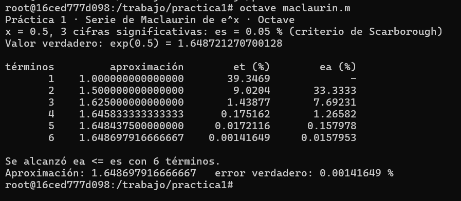
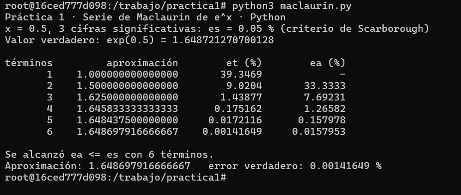
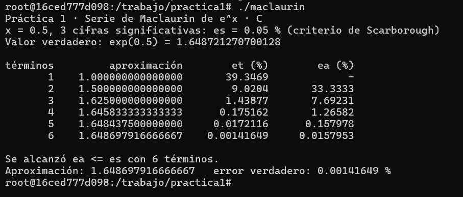

# Práctica 1 · La serie de Maclaurin y el criterio de paro

**UEA:** Métodos Numéricos en Ingeniería (1151039)  
**Trimestre:** 26-O  
**Institución:** Universidad Autónoma Metropolitana, Unidad Azcapotzalco  
**Profesor:** M. en C. Gabriel Hurtado Avilés

| Dato | Información |
|---|---|
| Estudiante | Luis Roberto Varela López |
| Matrícula | 2253001715 |
| Licenciatura | Ingeniería Mecánica |
| Modalidad de realización | Individual |
| Fecha | 12 de octubre de 2026 |

## 1. Ejecución en Octave y Python

Se ejecutaron los programas `maclaurin.m` y `maclaurin.py` sin modificar su procedimiento original, utilizando tres cifras significativas y el valor \(x = 0.5\).

Ambos programas generaron tablas idénticas. Se necesitaron seis términos para alcanzar el criterio de paro, con una aproximación de 1.648697916666667 y un error relativo verdadero de 0.00141649 %.

Los resultados son consistentes entre ambos programas. Queda pendiente verificar directamente su coincidencia con la lámina 25 de la unidad I.

**Evidencia de Octave:**



**Evidencia de Python:**



## 2. Programa en C

Se completaron las dos instrucciones indicadas en `maclaurin.c`:

```c
/* COMPLETAR 1 */
termino = termino * X / n;

/* COMPLETAR 2 */
ea = fabs((aprox - anterior) / aprox) * 100.0;
```

La primera instrucción calcula cada nuevo término de la serie a partir del anterior. La segunda obtiene el error relativo aproximado porcentual entre dos sumas consecutivas.

El programa se compiló mediante:

```bash
gcc -O2 -std=c17 -Wall -o maclaurin maclaurin.c -lm
```

Su ejecución produjo una tabla idéntica a las de Octave y Python, alcanzando el criterio de paro con seis términos.

**Evidencia de C:**



## 3. Experimento con cifras significativas

Se modificó temporalmente la variable `CIFRAS` del programa de Python para evaluar tres niveles de precisión: 3, 6 y 17 cifras significativas.

| Cifras significativas | Error permitido εs (%) | Términos | Aproximación | Error verdadero εt (%) |
|---|---|---|---|---|
| 3 | 0.05 | 6 | 1.648697916666667 | 0.00141649 |
| 6 | 0.00005 | 9 | 1.648721265035962 | 3.43549 × 10⁻⁷ |
| 17 | 5 × 10⁻¹⁶ | 16 | 1.648721270700128 | 2.69354 × 10⁻¹⁴ |

Después del experimento se restauró el valor original `CIFRAS = 3`.

### Pregunta 1. ¿Cuántos términos hacen falta en cada caso?

Para tres cifras significativas se necesitan seis términos; para seis cifras, nueve términos; y para diecisiete cifras, el programa se detiene después de dieciséis términos.

Al exigir mayor precisión, generalmente aumenta el número de términos necesarios para satisfacer el criterio de paro.

### Pregunta 2. ¿El error aproximado es mayor o menor que el error verdadero? ¿Por qué conviene detenerse con el error aproximado?

En las ejecuciones de tres y seis cifras, el error aproximado final fue mayor que el error verdadero. Sin embargo, esta relación no es universal: depende de la función, del método y del comportamiento de las aproximaciones.

El error verdadero necesita conocer el valor exacto o un valor de referencia suficientemente preciso. En cambio, el error aproximado puede calcularse utilizando únicamente dos aproximaciones consecutivas.

Por ello resulta conveniente utilizar el error aproximado como criterio práctico de paro cuando no se conoce la solución exacta.

### Pregunta 3. ¿Cuántas cifras son realmente correctas al solicitar diecisiete? ¿Cómo se relaciona con 0.1 + 0.2?

Al solicitar diecisiete cifras significativas, el programa se detuvo en el término dieciséis porque el error aproximado calculado llegó a cero.

Esto ocurrió porque las dos últimas aproximaciones almacenadas fueron iguales dentro de la precisión disponible en la computadora. No significa que el resultado sea matemáticamente exacto.

Los números de punto flotante de doble precisión permiten representar aproximadamente entre quince y dieciséis cifras decimales significativas. Por ello no podemos asegurar diecisiete cifras correctas mediante esta ejecución.

Este fenómeno se relaciona con el ejemplo `0.1 + 0.2` de la Tarea 1: ciertos números decimales no tienen una representación binaria exacta y las operaciones pueden producir pequeños errores de redondeo.

## 4. Conclusiones

La serie de Maclaurin permitió aproximar \(e^{0.5}\) mediante la suma sucesiva de términos. Los programas de Octave, Python y C coincidieron para tres cifras significativas.

El experimento mostró que una mayor exigencia de precisión requiere más términos, pero también evidenció las limitaciones de la aritmética de punto flotante. El error aproximado constituye una herramienta útil para detener las iteraciones, aunque debe interpretarse con cuidado cuando se alcanza la precisión de máquina.

## 5. Uso de inteligencia artificial

Se utilizaron ChatGPT y Codex como herramientas de apoyo para completar y revisar las instrucciones del programa en C, interpretar los resultados numéricos, organizar las respuestas y preparar la documentación.

Las ejecuciones de los programas y las capturas de pantalla se realizaron localmente mediante Docker.

## 6. Referencias

- Chapra, S. C., y Canale, R. P. (2015). *Métodos numéricos para ingenieros* (7.ª ed.). McGraw-Hill.
- Burden, R. L., y Faires, J. D. (2011). *Análisis numérico* (9.ª ed.). Cengage Learning.
- Material de la Práctica 1 y programas de referencia proporcionados para la UEA Métodos Numéricos en Ingeniería, UAM Azcapotzalco.