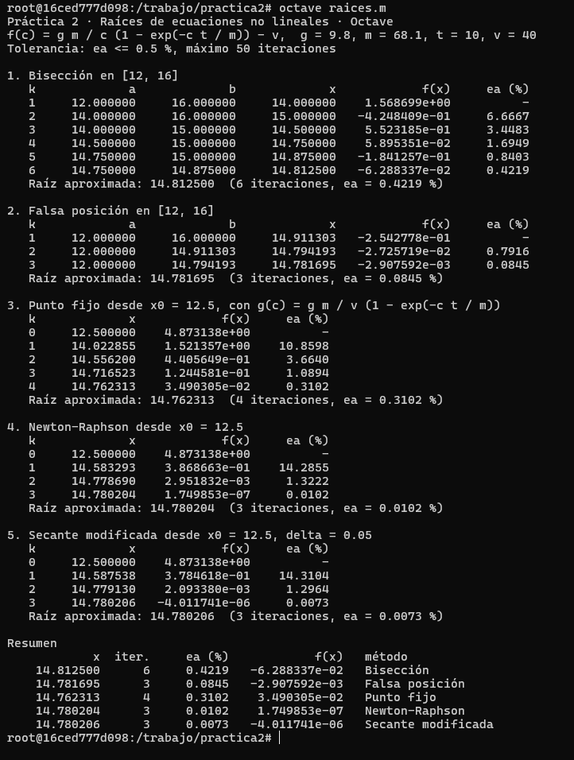
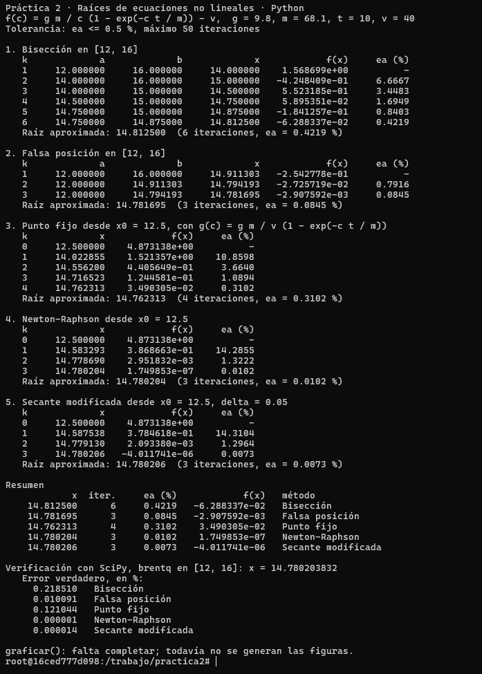
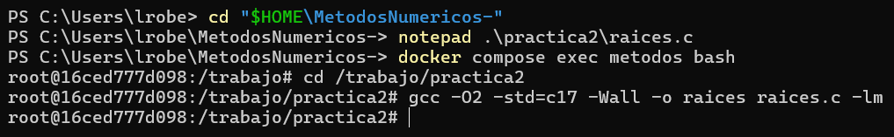
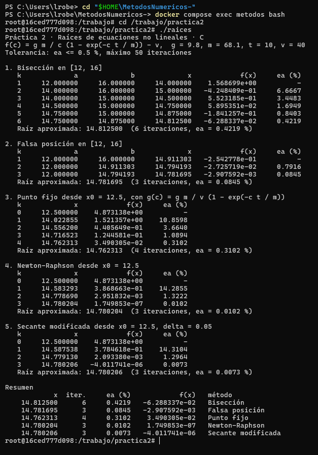
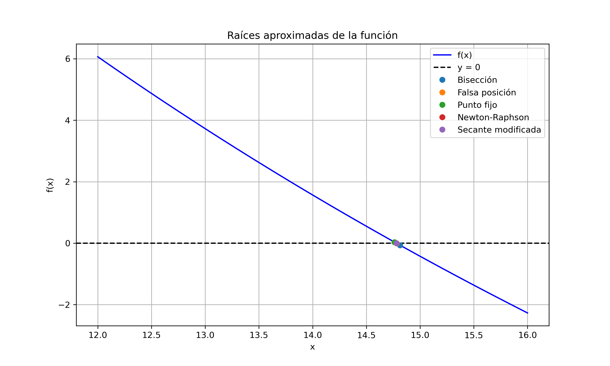
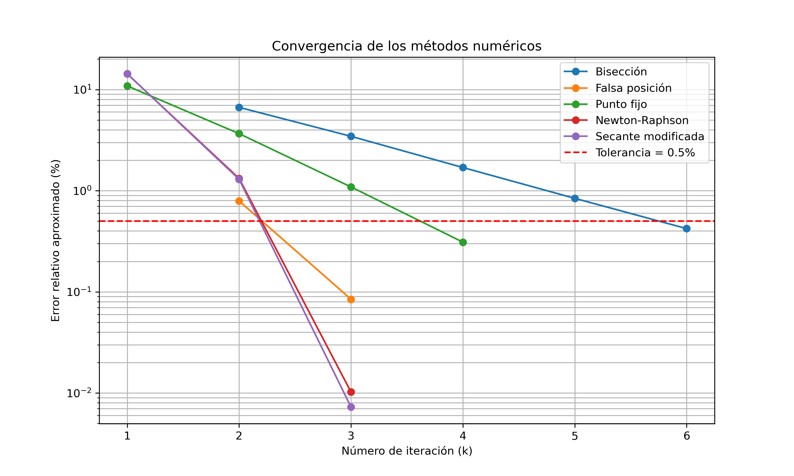
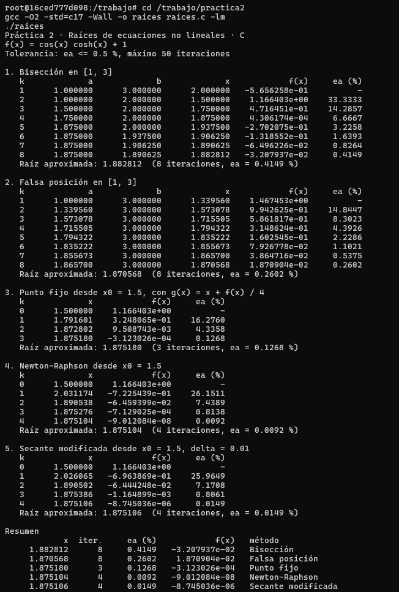

# Práctica 2 · Raíces de ecuaciones no lineales

**UEA 1151039 · Métodos Numéricos en Ingeniería · Trimestre 26-O · UAM Azcapotzalco**
**Profesor:** M. en C. Gabriel Hurtado Avilés

| | |
|---|---|
| Equipo | Trabajo individual |
| Integrantes (nombre, matrícula y licenciatura) | Luis Roberto Varela López · 2253001715 · Ingeniería Mecánica |
| Ecuación asignada | 23 · Vibración de un voladizo (seleccionada para esta entrega) |
| Fecha | 17 de octubre de 2026 |

---

## 1. Octave y Python con el paracaidista

Capturas de `octave raices.m` y de `python3 raices.py` sin cambiar nada. Sus tablas
coinciden con las de las láminas de la unidad II.




## 2. Las cinco líneas que completamos en `raices.c`

```c
/* COMPLETAR 1: Error relativo aproximado */
return fabs((nuevo - anterior) / nuevo) * 100.0;

/* COMPLETAR 2: Falsa posición */
x = b - f(b) * (a - b) / (f(a) - f(b));

/* COMPLETAR 3: Punto fijo */
x_nuevo = g(x);

/* COMPLETAR 4: Newton-Raphson */
x_nuevo = x - f(x) / fp(x);

/* COMPLETAR 5: Secante modificada */
x_nuevo = x - delta * f(x) / (f(x + delta) - f(x));
```





¿Coinciden las tablas de C con las de Octave y Python? Sí / No, y en qué.

**Comparación de resultados**

Sí. Los programas de C y Octave produjeron tablas idénticas en los valores mostrados, incluyendo las aproximaciones, los errores relativos y el número de iteraciones. El programa de Python también obtuvo las mismas raíces e iteraciones.

| Método | Raíz aproximada | Iteraciones | Error aproximado (%) |
|---|---:|---:|---:|
| Bisección | 14.812500 | 6 | 0.4219 |
| Falsa posición | 14.781695 | 3 | 0.0845 |
| Punto fijo | 14.762313 | 4 | 0.3102 |
| Newton-Raphson | 14.780204 | 3 | 0.0102 |
| Secante modificada | 14.780206 | 3 | 0.0073 |

Los cinco métodos alcanzaron la tolerancia establecida de 0.5 %. Bisección necesitó seis iteraciones, mientras que falsa posición, Newton-Raphson y secante modificada necesitaron tres. Las diferencias entre las raíces aproximadas se deben a que cada método sigue un procedimiento distinto y se detiene cuando satisface el criterio de error relativo aproximado.
## 3. Las gráficas de Python — ecuación 23




### Interpretación de las gráficas

`funcion.png` representa cos(x) cosh(x) + 1 en [1, 3] y las cinco aproximaciones.
`convergencia.png` muestra εa (%) en escala logarítmica, omitiendo los errores no definidos
al inicio de los métodos cerrados. Todas las curvas cruzan la tolerancia de 0.5 %.
Estas figuras corresponden al voladizo; las capturas anteriores conservan el ejemplo del paracaidista. También se preservan sus gráficas: [función original](img/funcion-paracaidista.png) y [convergencia original](img/convergencia-paracaidista.png).

## 4. Nuestra ecuación: 23 · Vibración de un voladizo

La condición de una viga empotrada y libre es cos(βL) cosh(βL) + 1 = 0.
La incógnita x = βL es adimensional; los argumentos trigonométricos están en radianes.

| Dato | Valor |
|---|---|
| f(x) | cos(x) cosh(x) + 1 |
| f′(x) | −sen(x) cosh(x) + cos(x) senh(x) |
| g(x) | x + f(x)/4 |
| [a, b] | [1, 3] |
| x₀; δ | 1.5; 0.01 (incremento absoluto) |
| Tolerancia; máximo | εa ≤ 0.5 %; 50 iteraciones |

Se usa εa = 100 |(xₖ − xₖ₋₁)/xₖ|. No se impone una tolerancia de 0.5 al
residuo: f(x), εa y el error verdadero son cantidades diferentes.

### Tablas (salida real de C)

**1. Bisección en [1, 3]**

| k | a | b | x | f(x) | εa (%) |
| --- | --- | --- | --- | --- | --- |
| 1 | 1.000000 | 3.000000 | 2.000000 | -5.656258e-01 | - |
| 2 | 1.000000 | 2.000000 | 1.500000 | 1.166403e+00 | 33.3333 |
| 3 | 1.500000 | 2.000000 | 1.750000 | 4.716451e-01 | 14.2857 |
| 4 | 1.750000 | 2.000000 | 1.875000 | 4.306174e-04 | 6.6667 |
| 5 | 1.875000 | 2.000000 | 1.937500 | -2.702075e-01 | 3.2258 |
| 6 | 1.875000 | 1.937500 | 1.906250 | -1.318552e-01 | 1.6393 |
| 7 | 1.875000 | 1.906250 | 1.890625 | -6.496226e-02 | 0.8264 |
| 8 | 1.875000 | 1.890625 | 1.882812 | -3.207937e-02 | 0.4149 |

**2. Falsa posición en [1, 3]**

| k | a | b | x | f(x) | εa (%) |
| --- | --- | --- | --- | --- | --- |
| 1 | 1.000000 | 3.000000 | 1.339560 | 1.467453e+00 | - |
| 2 | 1.339560 | 3.000000 | 1.573078 | 9.942625e-01 | 14.8447 |
| 3 | 1.573078 | 3.000000 | 1.715505 | 5.861817e-01 | 8.3023 |
| 4 | 1.715505 | 3.000000 | 1.794322 | 3.148624e-01 | 4.3926 |
| 5 | 1.794322 | 3.000000 | 1.835222 | 1.602545e-01 | 2.2286 |
| 6 | 1.835222 | 3.000000 | 1.855673 | 7.926778e-02 | 1.1021 |
| 7 | 1.855673 | 3.000000 | 1.865700 | 3.864716e-02 | 0.5375 |
| 8 | 1.865700 | 3.000000 | 1.870568 | 1.870904e-02 | 0.2602 |

**3. Punto fijo desde x0 = 1.5, con g(x) = x + f(x) / 4**

| k | x | f(x) | εa (%) |
| --- | --- | --- | --- |
| 0 | 1.500000 | 1.166403e+00 | - |
| 1 | 1.791601 | 3.248065e-01 | 16.2760 |
| 2 | 1.872802 | 9.508743e-03 | 4.3358 |
| 3 | 1.875180 | -3.123026e-04 | 0.1268 |

**4. Newton-Raphson desde x0 = 1.5**

| k | x | f(x) | εa (%) |
| --- | --- | --- | --- |
| 0 | 1.500000 | 1.166403e+00 | - |
| 1 | 2.031174 | -7.225439e-01 | 26.1511 |
| 2 | 1.890538 | -6.459399e-02 | 7.4389 |
| 3 | 1.875276 | -7.129025e-04 | 0.8138 |
| 4 | 1.875104 | -9.012084e-08 | 0.0092 |

**5. Secante modificada desde x0 = 1.5, delta = 0.01**

| k | x | f(x) | εa (%) |
| --- | --- | --- | --- |
| 0 | 1.500000 | 1.166403e+00 | - |
| 1 | 2.026065 | -6.963869e-01 | 25.9649 |
| 2 | 1.890502 | -6.444248e-02 | 7.1708 |
| 3 | 1.875386 | -1.164899e-03 | 0.8061 |
| 4 | 1.875106 | -8.745036e-06 | 0.0149 |

### Resumen

| Método | Raíz | Iteraciones | εa (%) | f(raíz) | Error verdadero (%) |
|---|---:|---:|---:|---:|---:|
| Bisección | 1.882812500000 | 8 | 0.41493776 | -3.20793663e-02 | 0.41109352 |
| Falsa posición | 1.870567850147 | 8 | 0.26023247 | 1.87090403e-02 | 0.24191823 |
| Punto fijo | 1.875179533953 | 3 | 0.12677110 | -3.12302581e-04 | 0.00402459 |
| Newton-Raphson | 1.875104090490 | 4 | 0.00918524 | -9.01208439e-08 | 0.00000116 |
| Secante modificada | 1.875106181989 | 4 | 0.01489687 | -8.74503585e-06 | 0.00011270 |

Raíz de referencia SciPy (Brent): **1.875104068711961**.
Una bisección independiente con series de Taylor y aritmética Decimal de 60 dígitos confirma
1.87510406871196116644530824107821416257011173353106998824539.

### Análisis

La función es continua. En [0, π/2], cos(x) ≥ 0 y f(x) ≥ 1, de modo que no hay
raíces positivas anteriores. En (π/2, 3], sen(x) > 0 y cos(x) < 0, por lo que
f′(x) < 0. Como f(1) > 0 y f(3) < 0, hay exactamente una raíz en [1, 3],
y es la primera positiva.

Punto fijo necesita menos iteraciones (3): cerca de la raíz,
g′(x*) = 1 + f′(x*)/4 ≈ −0.0345, de magnitud pequeña y menor que uno.
Esto explica su rápida convergencia local y la alternancia al acercarse a la raíz;
no implica que el despeje sea contractivo en todo [1, 3]. Newton necesita 4 iteraciones
porque su primer paso desde 1.5 sobrepasa la raíz. Su derivada analítica permite una
corrección final más precisa que la diferencia hacia adelante de secante modificada,
que también tarda 4 pasos.

Bisección y falsa posición requieren 8 iteraciones. En falsa posición el extremo
b = 3 permanece fijo: la asimetría de los valores de f en los extremos hace más lento
el avance. Bisección reduce sistemáticamente el intervalo, pero no el error verdadero
en cada paso: en k = 4 pasa muy cerca de la raíz y aun así continúa porque εa supera
0.5 %. No se alteró el criterio prescrito para aprovechar esa coincidencia.

Los cinco métodos cumplen εa ≤ 0.5 % y, comprobado por separado, error verdadero ≤ 0.5 %.
Las aproximaciones difieren porque se detienen con cambios relativos pequeños, sin
exigir precisión de máquina. El menor εa no garantiza por sí solo el menor error verdadero.

La frecuencia fundamental es ω₁ = x*² √(EI/(mL⁴)) ≈ 3.516015269 √(EI/(mL⁴)),
con m como masa por unidad de longitud. No se puede dar una frecuencia en rad/s ni Hz
sin E, I, m y L; para Hz se divide ω₁ entre 2π.

### Evidencia y reproducción

- [Salida completa de C](resultados/salida_c.txt).
- [Salida completa de Python y comparación con SciPy](resultados/salida_python.txt).
- [Verificación y versiones del entorno](resultados/verificacion.txt).
- `python3 verificar.py` compila C con advertencias tratadas como errores, ejecuta ambos
  programas, compara todas sus tablas, verifica la derivada por diferencias centrales,
  contrasta Brent con una raíz independiente y comprueba ambas tolerancias y la parada.

Estas ejecuciones se realizaron en el entorno Linux de ChatGPT Work, con GCC, Python,
NumPy, SciPy y Matplotlib indicados en el archivo de verificación. Docker y Octave no
están instalados aquí. No se afirma haber vuelto a ejecutar Docker u Octave.
`raices.m` permanece intacto y conserva el paracaidista, según `COMO_CORRER.md`.
Las salidas de texto son evidencia real de ejecución; no se fabricaron capturas de terminal.

## 5. Cada integrante en su computadora

Cada integrante corre `raices.c` con la ecuación del equipo en su propia computadora y sube
su captura con un commit propio (ver `COMO_CORRER.md`, sección 7).

| Integrante | Usuario de GitHub | Captura |
|---|---|---|
| Luis Roberto Varela López | lrobertovarelal-arch | [Ver captura](img/07-integrante-varela.png) |




## Uso de inteligencia artificial

Se utilizó ChatGPT (OpenAI) como herramienta de apoyo durante el desarrollo de la práctica. Su uso consistió en explicar los fundamentos matemáticos de los cinco métodos numéricos, orientar la implementación de las fórmulas faltantes en C, apoyar la programación de las gráficas en Python y colaborar en la interpretación de los resultados y la redacción de la documentación.

La evidencia previa del paracaidista se conserva. Para la ecuación 23, ChatGPT Work modificó y ejecutó Python y C, generó las gráficas, realizó las verificaciones reproducibles y completó el análisis. La captura personal del estudiante sigue pendiente; no se presenta la ejecución remota como evidencia de su computadora.

## Referencias

- Chapra, S. C., y Canale, R. P. (2015). *Métodos numéricos para ingenieros* (7.ª ed.). McGraw-Hill Education.
- Burden, R. L., y Faires, J. D. (2011). *Análisis numérico* (9.ª ed.). Cengage Learning.
- Hurtado Avilés, G. (2026). *Métodos Numéricos en Ingeniería, Unidad II: Raíces de ecuaciones no lineales*. Material del curso, UAM Azcapotzalco.
- OpenAI. (2026). *ChatGPT*. https://chatgpt.com/
