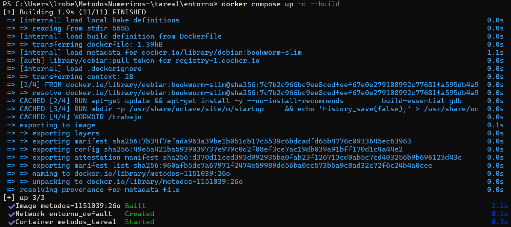
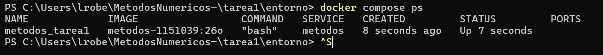
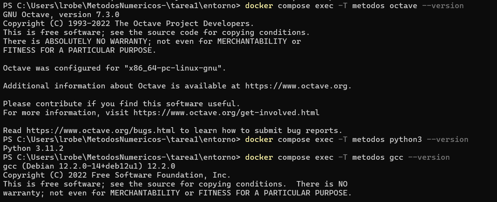
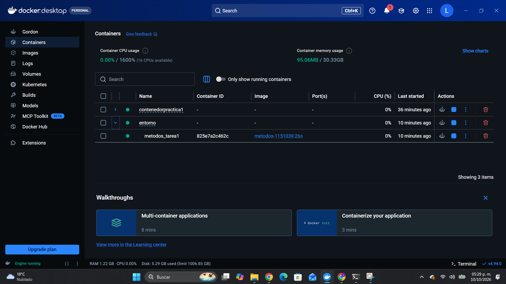
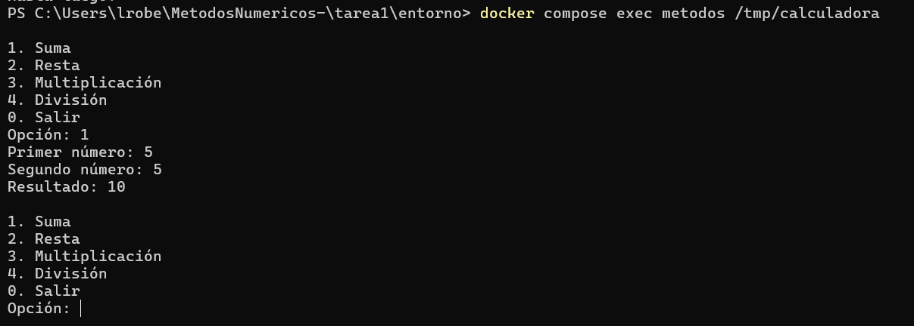

# Tarea 1: Introducción a los métodos numéricos y entorno de trabajo

| Dato | Información |
|---|---|
| Universidad | Universidad Autónoma Metropolitana, Unidad Azcapotzalco |
| División | Ciencias Básicas e Ingeniería |
| UEA | Métodos Numéricos en Ingeniería |
| Clave | 1151039 |
| Trimestre | 26-O |
| Licenciatura | Ingeniería Mecánica |
| Alumno | Luis Roberto Varela López |
| Matrícula | 2253001715 |
| Profesor | M. en C. Gabriel Hurtado Avilés |
| Fecha de entrega | 10 de octubre de 2026 |
| Fecha límite indicada | 10 de octubre de 2026, 23:59, Ciudad de México |
| Repositorio personal | https://github.com/lrobertovarelal-arch/MetodosNumericos- |

**Estado: implementación y pruebas remotas completas; revisión académica y
capturas de Windows pendientes.** Preparada para la rama `work`; integración en
`main` pendiente de pruebas locales, capturas y autorización del alumno.

El PDF `26-O_1151039_Tarea_1_Introduccion_y_entorno.pdf` no está disponible en el
entorno. Esta entrega sigue los requisitos detallados por el alumno. El orden,
las instrucciones de los programas y las cinco evidencias deben contrastarse
con el documento oficial antes de considerarla definitiva.

**Bibliografía provisional:** las referencias de Burden y Faires y de Chapra y
Canale fueron proporcionadas en la solicitud. Las consultas a las fichas
editoriales están bloqueadas por la red del entorno. Las citas siguientes son
paráfrasis temáticas, sin citas textuales ni páginas atribuidas; los datos de la
edición y la correspondencia con los libros del programa requieren verificación.
No se afirma haber consultado sus textos completos.

## Ejercicio 1: organización del repositorio

```text
MetodosNumericos-/
├── LICENSE
├── .gitignore
├── README.md
├── ContenedorPractica1/             (sin cambios)
├── ContenedorPractica2/             (sin cambios)
└── tarea1/
    ├── README.md
    ├── verificar.py
    ├── img/
    │   └── README.md                (instrucciones; las cinco PNG están pendientes)
    ├── entorno/
    │   ├── Dockerfile
    │   └── compose.yaml
    ├── programa1-suma/
    │   ├── suma.c
    │   ├── suma.py
    │   └── suma.m
    └── programa2-calculadora/
        └── calculadora.c
```

La [licencia MIT](../LICENSE) identifica a Luis Roberto Varela López y el año 2026.
El [`.gitignore`](../.gitignore) excluye los ejecutables conocidos, objetos,
cachés de Python, `octave-workspace`, archivos del editor y archivos `.env`;
conserva fuentes e imágenes de evidencia. `verificar.py` es un archivo adicional
para repetir las pruebas y genera sus binarios en `/tmp`, fuera del repositorio.

El [Dockerfile](entorno/Dockerfile) es una copia sin cambios del disponible en
`ContenedorPractica1/`. El [Compose](entorno/compose.yaml) conserva el servicio
`metodos`, la imagen del curso y sus variables. Se adaptaron solamente el nombre
del contenedor (`metodos_tarea1`) y el volumen: `../:/trabajo` monta **tarea1**,
no únicamente `entorno`. Las rutas relativas se resuelven desde el archivo Compose.
Esto permite acceder a ambos programas y evita ocupar `metodos_equipo`.

### Historial y estado público

El repositorio es público según lo indicado por su propietario; no se cambió su
visibilidad. El historial local disponible al iniciar esta tarea contiene:

| Commit | Fecha registrada por Git | Mensaje |
|---|---|---|
| `1175f7c` | 2026-10-05 | Create README.md |
| `e4d08d1` | 2026-10-05 | Practica 1 |
| `aae3bba` | 2026-10-07 | Contenedor 2 |
| `c76757d` | 2026-10-10 | Corrige la serie de Maclaurin en C y documenta la validación de Práctica 1 |

Son **cuatro commits en tres días distintos**. El requisito de al menos cinco
commits en días diferentes no se cumple con este historial. No se alteraron
fechas ni se crearon commits para simular trabajo pasado. Un commit nuevo el
mismo 10 de octubre no resolvería los días faltantes. Debe comunicarse esta
limitación al profesor; no puede subsanarse retrospectivamente de forma honesta.

## Ejercicio 2: investigación

### 1. ¿Qué son los métodos numéricos?

Los métodos numéricos son procedimientos que transforman un problema matemático
en operaciones aritméticas ejecutables para calcular una solución. Por ejemplo,
permiten encontrar una raíz de una ecuación, resolver un sistema lineal,
aproximar una integral o obtener la evolución de un sistema de ecuaciones
diferenciales. El algoritmo debe definir las operaciones, las condiciones para
aplicarlas y una forma de evaluar si el resultado tiene la precisión necesaria
(Burden y Faires, 2011; Chapra y Canale, 2015).

Una solución analítica expresa la respuesta mediante relaciones matemáticas,
como una fórmula en términos de funciones conocidas. Una solución numérica
normalmente proporciona valores en puntos o instantes seleccionados. Las dos
se complementan: una fórmula puede necesitar evaluación numérica, y una solución
analítica sencilla puede servir para comprobar un algoritmo. La ausencia de una
fórmula cerrada no implica que el problema carezca de solución.

Las aproximaciones aparecen por diferentes motivos. Un modelo ya simplifica el
sistema físico; además, un algoritmo puede reemplazar una derivada por diferencias
finitas o una serie infinita por un número limitado de términos. Finalmente, la
computadora representa los números con una cantidad finita de bits. Conviene
distinguir el **error de truncamiento**, causado por cortar un proceso matemático
infinito o discretizarlo, del **error de redondeo**, causado por esa representación
finita. El error de aproximación describe la diferencia entre una aproximación y
la referencia; puede contener ambas contribuciones (Burden y Faires, 2011).

Si se conoce una referencia x, el error absoluto es |x − x_aprox| y el relativo es
|x − x_aprox| / |x| cuando x ≠ 0. Cuando no se conoce la solución, pueden emplearse
residuos, estimadores de error y diferencias entre iteraciones. Un residuo pequeño
no siempre asegura una solución precisa: también influye el condicionamiento del
problema. La convergencia significa que las aproximaciones se acercan al objetivo
al refinar la discretización o continuar las iteraciones bajo las hipótesis del
método. Un criterio de paro debe considerar una tolerancia útil para la aplicación
y un límite de trabajo; pedir más decimales que los representables no aumenta la
precisión física ni computacional (Chapra y Canale, 2015).

### 2. Aplicaciones en Ingeniería Mecánica

**Esfuerzos, deformaciones y desplazamientos de un componente.** En un soporte
mecánico sometido a cargas se calculan los desplazamientos u, las deformaciones ε
y los esfuerzos σ. En elasticidad lineal de pequeñas deformaciones, el equilibrio
estático se expresa como ∇·σ + b = 0, la deformación como
ε = (∇u + (∇u)ᵀ)/2 y la relación constitutiva como σ = C:ε, donde b representa
las fuerzas por unidad de volumen y C las propiedades elásticas. Se agregan las
restricciones de movimiento y las cargas de frontera.

Una barra uniforme permite fórmulas sencillas, pero un soporte con orificios,
cambios de sección y cargas distribuidas difíciles de idealizar requiere resolver
un campo espacial. El método de elementos finitos divide la geometría en elementos,
aproxima u mediante funciones de interpolación y ensambla un sistema K u = f.
Ese sistema puede resolverse mediante factorizaciones directas o métodos iterativos
para matrices dispersas. La solución ayuda a elegir dimensiones y materiales,
controlar desplazamientos y localizar concentraciones de esfuerzo. Antes de aceptar
el diseño se revisan equilibrio, condiciones de frontera, refinamiento de malla y
validez del modelo; una singularidad geométrica puede producir esfuerzos máximos
que no convergen al refinar la malla. El uso de sistemas de ecuaciones y métodos
numéricos en problemas de ingeniería se desarrolla en Chapra y Canale (2015).

**Transferencia de calor en una pieza.** En una pieza mecánica que recibe calor se
calculan la temperatura T, sus gradientes y el flujo de conducción q = −k∇T.
Para un sólido sin transporte por movimiento, un modelo transitorio es
ρ c_p ∂T/∂t = ∇·(k∇T) + Q, donde ρ es la densidad, c_p el calor específico,
k la conductividad y Q una fuente volumétrica. En régimen estacionario el término
temporal es cero. Se especifican temperaturas, flujos o intercambio convectivo
en las superficies; por ejemplo, el flujo saliente por convección es
h(T_superficie − T_ambiente).

Una pared plana homogénea con condiciones sencillas admite soluciones analíticas.
Una pieza con varias regiones, calentamiento localizado o geometría compleja puede
requerir diferencias finitas, volúmenes finitos o elementos finitos. Para un problema
transitorio también se discretiza el tiempo; la elección del paso debe considerar
estabilidad y precisión. Las temperaturas calculadas permiten seleccionar
refrigeración, aislamiento y materiales, o detectar gradientes que pueden provocar
dilatación y esfuerzos térmicos. La comparación entre mallas y pasos temporales
ayuda a comprobar que las decisiones no dependan de una discretización demasiado
gruesa (Chapra y Canale, 2015; Burden y Faires, 2011).

### 3. Herramientas para métodos numéricos

La elección depende del tamaño del problema, las bibliotecas necesarias y la
facilidad para verificar el algoritmo. Las familias se pueden combinar; por ejemplo,
un programa de Python puede utilizar rutinas compiladas de álgebra lineal. Los
problemas de raíces, sistemas lineales, interpolación, integración y ecuaciones
diferenciales son temas centrales de los libros citados (Burden y Faires, 2011;
Chapra y Canale, 2015).

| Familia | Herramientas | Función y consideraciones |
|---|---|---|
| Lenguajes compilados | C, C++, Fortran | Implementan algoritmos y aplicaciones de alto rendimiento. C permite estudiar explícitamente tipos, ciclos y operaciones; C++ agrega abstracciones y Fortran tiene una larga tradición en cómputo científico. El rendimiento depende también del algoritmo y las bibliotecas. |
| Lenguajes interpretados o de uso interactivo | Python y otros lenguajes de guiones | Facilitan experimentar, automatizar tareas y visualizar resultados. Los ciclos interpretados pueden ser costosos, pero las operaciones de bibliotecas pueden ejecutarse como código compilado. |
| Entornos matriciales | MATLAB, GNU Octave | Ofrecen operaciones con vectores y matrices, solvers y gráficas. Octave es software libre con amplia compatibilidad de lenguaje con MATLAB, aunque no todos los paquetes y funciones son intercambiables. |
| Python científico | NumPy, SciPy, Matplotlib | NumPy aporta arreglos y operaciones numéricas; SciPy reúne algoritmos de optimización, integración y álgebra lineal; Matplotlib permite representar datos. |
| Álgebra simbólica | SymPy y sistemas de álgebra computacional | Manipulan expresiones y pueden obtener derivadas o integrales simbólicas. No garantizan una fórmula cerrada para cualquier problema; también pueden generar referencias para contrastar aproximaciones. |
| Bibliotecas de álgebra lineal | BLAS, LAPACK | BLAS ofrece operaciones básicas de vectores y matrices; LAPACK implementa factorizaciones y solvers de álgebra lineal principalmente densa. Muchas herramientas científicas las utilizan internamente. |

Los nombres y funciones de software se distinguen de las referencias académicas.
No se atribuye un lenguaje concreto a una edición de un libro sin haber comprobado
su prólogo, contenido o recursos. Esa comprobación queda pendiente para los dos
libros recomendados: no se infiere que emplean los tres lenguajes del curso.

### 4. Herramientas utilizadas en el curso

**Docker** permite preparar una imagen con el sistema de archivos y las dependencias
de trabajo y crear contenedores a partir de ella. Esto reduce diferencias entre
instalaciones. Un contenedor comparte el kernel del sistema Linux que lo ejecuta;
una máquina virtual incluye un sistema operativo invitado con su propio kernel.
En Windows 11, Docker Desktop puede utilizar WSL 2 para proporcionar el entorno
Linux. Por tanto, compartir kernel no significa ejecutar estos binarios Linux
directamente sobre el kernel de Windows.

El **Dockerfile** describe cómo construir la imagen: aquí parte de Debian Bookworm,
instala las herramientas y configura el directorio y las variables de entorno.
**compose.yaml** declara el servicio, la imagen, el montaje y las opciones de
arranque. Los programas están en el disco del usuario y se montan en `/trabajo`;
no deben confundirse con los archivos que solo existen en la capa del contenedor.

| Comando, desde `tarea1/entorno` en PowerShell | Función |
|---|---|
| `docker compose up -d --build` | Construye o reutiliza la imagen y deja el contenedor ejecutándose en segundo plano. |
| `docker compose up -d` | Crea o inicia el servicio utilizando la imagen disponible. |
| `docker compose exec metodos bash` | Abre una consola dentro del servicio ya iniciado. |
| `docker compose stop` | Detiene el contenedor y conserva su identidad y capa de archivos. |
| `docker compose down` | Elimina los contenedores y la red del proyecto; el montaje de archivos del usuario permanece en su disco. |
| `docker compose ps` | Muestra el estado del servicio. |
| `docker compose logs` | Muestra la salida del proceso principal; las ejecuciones interactivas con `exec` se observan en su propia terminal. |

`stop` y `down` no son equivalentes: después de `down`, los archivos guardados solo
en la capa del contenedor se pierden al eliminarlo. Los archivos del montaje
`tarea1/` permanecen en Windows. No se necesita publicar puertos porque los
programas de la tarea funcionan por terminal.

**GNU Octave** ejecuta el guion matricial `suma.m`; **Python** ejecuta `suma.py`
sin compilarlo manualmente; **C** debe compilarse y enlazarse con **GCC** antes de
ejecutar su binario. Las verificaciones remotas de esta entrega se realizaron con
GCC 12.2.0, Python 3.11.2 y GNU Octave 7.3.0, dentro de `metodos_tarea1`. Coinciden
con las versiones que el alumno informó haber comprobado localmente; eso no
convierte las pruebas remotas de estos nuevos programas en pruebas del alumno.

El Dockerfile fija la distribución base, pero no fija por versión cada paquete
ni el digest de la imagen. Una reconstrucción posterior puede recibir actualizaciones.
La imagen remota fue construida con el Dockerfile de `entorno/`, reutilizando capas
válidas ya instaladas. La resolución del proxy de la nube se configuró al construir,
fuera de los archivos del curso; no se desactivaron firmas ni verificaciones de paquetes.

En esta nube, `docker compose up -d --build` sin configuración del proxy no pudo
resolver `deb.debian.org`. La comprobación que sí pasó utilizó una extensión
Compose externa con `build.network: host` y los argumentos de proxy resueltos
dinámicamente, seguida de `docker compose up -d --no-build`. Se verificaron el
estado `Up`, el montaje y los programas. Esa extensión no forma parte de la
entrega: el comando estándar de Windows debe comprobarse en Docker Desktop.

## Ejercicio 3: evidencias de Windows 11

**Pendientes: 0 de 5 capturas PNG presentes.** No se incluyen imágenes creadas por
IA, ni resultados remotos presentados como evidencia de Windows. El directorio
[img](img/README.md) está preparado para recibirlas. Los enlaces de imagen que
siguen no se resolverán hasta agregar los PNG reales.

Con Docker Desktop abierto y usando contenedores Linux, abre PowerShell en la
raíz de tu copia local que contenga estos nuevos archivos. Ejecuta:

```powershell
cd .\tarea1\entorno
docker compose up -d --build
```

**01-up.png:** captura la terminal cuando termine el comando. En el primer arranque
normal debe aparecer `Started`. Si el contenedor ya existe y aparece `Running`,
puedes ejecutar `docker compose stop` y después `docker compose up -d --build`
para capturar un arranque real. No edites el texto de la salida. Guarda la captura
con `Win + Shift + S` como `tarea1\img\01-up.png` (equivale a `..\img\01-up.png`
desde `entorno`).



**02-ps.png:** ejecuta el siguiente comando y captura el contenedor
`metodos_tarea1` con `STATUS` igual a `Up`:

```powershell
docker compose ps
```



**03-versiones.png:** ejecuta y captura las tres versiones obtenidas *dentro*:

```powershell
docker compose exec metodos bash -lc 'octave-cli --version | head -n 1; python3 --version; gcc --version | head -n 1'
```



**04-docker-desktop.png:** abre la vista Containers de Docker Desktop, identifica
`metodos_tarea1` dentro del proyecto Compose `entorno` y captura su estado en
funcionamiento. Si el PDF exige específicamente otro nombre, contrástalo antes de
entregar; este nombre evita interferir con el contenedor de la Práctica 1.



**05-programas.png:** ejecuta estos comandos desde el mismo PowerShell. Generan
binarios temporales dentro del contenedor y prueban los dos programas, incluyendo
las tres implementaciones de suma:

```powershell
docker compose exec metodos gcc -O2 -std=c17 -Wall -Wextra -Werror -o /tmp/suma programa1-suma/suma.c -lm
docker compose exec metodos gcc -O2 -std=c17 -Wall -Wextra -Werror -o /tmp/calculadora programa2-calculadora/calculadora.c -lm
docker compose exec metodos /tmp/suma
docker compose exec metodos python3 programa1-suma/suma.py
docker compose exec metodos octave-cli --quiet programa1-suma/suma.m
docker compose exec metodos /tmp/calculadora
```

En la calculadora introduce una opción y cada operando en una línea separada:
`1`, `2`, `3`, luego `0`. Debe mostrar `Resultado: 5` y despedirse. Captura la
terminal con la ejecución de suma y calculadora visibles. Ajusta el tamaño de la
ventana antes de ejecutar si es necesario, sin alterar el contenido.



Después de guardar los PNG, confirma desde PowerShell:

```powershell
Get-ChildItem ..\img\*.png
```

## Ejercicio 4: programas y pruebas

### Programa 1: suma en C, Python y Octave

Los archivos [suma.c](programa1-suma/suma.c), [suma.py](programa1-suma/suma.py) y
[suma.m](programa1-suma/suma.m) reciben cero o dos argumentos. Sin argumentos
usan 0.1 y 0.2. Con dos argumentos aceptan decimales con signo y exponente
opcional, como `-2.5`, `.5` o `1e2`. Rechazan texto adicional, cantidades no finitas,
argumentos incompletos y sumas que desbordan el rango. No aceptan números
hexadecimales ni coma decimal: se utiliza el punto. Valores demasiado pequeños
pueden redondearse a cero según la representación de doble precisión.

Para otros valores, desde PowerShell en `tarea1/entorno`, tras compilar `/tmp/suma`:

```powershell
docker compose exec metodos /tmp/suma -2.5 1.25
docker compose exec metodos python3 programa1-suma/suma.py -2.5 1.25
docker compose exec metodos octave-cli --quiet programa1-suma/suma.m -2.5 1.25
```

Los tres imprimen con 17 cifras significativas, usando `%.17g` o su equivalente.
**Resultado remoto observado en los tres para 0.1 + 0.2:**

```text
0.30000000000000004
```

En base 2, 0.1 y 0.2 tienen expansiones infinitas periódicas. Al almacenarlos en
doble precisión se redondean a números binarios próximos. La suma se redondea otra
vez, y el número almacenado no coincide con el decimal exacto 0.3. La impresión
con 17 cifras hace visible esa diferencia. C (`double`), Python (`float`) y Octave
(`double`) coinciden en el entorno probado; no se necesita cambiar de lenguaje
para evitar el redondeo. Esta es una limitación de representación, no una falla
de la suma. Los números y los errores de representación son parte del análisis
numérico (Burden y Faires, 2011; referencia provisional).

### Programa 2: calculadora en C

[calculadora.c](programa2-calculadora/calculadora.c) repite un menú con
`1` suma, `2` resta, `3` multiplicación, `4` división y `0` salir. Lee una entrada
por línea mediante `fgets` y convierte con `strtod`, comprobando que no quede
texto adicional y que el número sea finito. Si una entrada es inválida, se cancela
esa operación y se vuelve al menú. También se maneja el fin de entrada sin quedar
en un ciclo infinito. Una línea demasiado larga se descarta completa antes de
volver a leer. La división por cero y un resultado desbordado producen mensajes,
permitiendo seguir usando el programa.

Compilación y ejecución dentro de la consola del contenedor:

```bash
cd /trabajo
gcc -O2 -std=c17 -Wall -Wextra -Werror -o /tmp/calculadora programa2-calculadora/calculadora.c -lm
/tmp/calculadora
```

### Tabla de pruebas ejecutadas

La siguiente tabla corresponde a **ejecuciones reales en el contenedor remoto**.
En la columna de entradas, cada elemento separado por `→` es una línea distinta.
No se atribuyen estas pruebas a Windows 11 ni al alumno.

| Caso | Entradas | Resultado esperado | Resultado observado |
|---|---|---|---|
| Suma | `1 → 2 → 3 → 0` | 5 y salida | `Resultado: 5`; `Hasta luego.` |
| Resta | `2 → 7 → 10 → 0` | −3 y salida | `Resultado: -3`; `Hasta luego.` |
| Multiplicación | `3 → -2 → 4 → 0` | −8 y salida | `Resultado: -8`; `Hasta luego.` |
| División válida | `4 → 7 → 2 → 0` | 3.5 y salida | `Resultado: 3.5`; `Hasta luego.` |
| División entre cero y recuperación | `4 → 5 → 0 → 1 → 2 → 3 → 0` | Aviso, luego suma igual a 5 | `Error: división entre cero.`; `Resultado: 5`; salida |
| Menú no numérico | `abc → 1 → 2 → 3 → 0` | Aviso y recuperación | `Error: entrada no numérica.`; `Resultado: 5` |
| Operando no numérico | `1 → abc → 2 → 7 → 10 → 0` | Cancelación y resta posterior | `Error: entrada no numérica.`; `Resultado: -3` |
| Salir | `0` | Terminar normalmente | `Hasta luego.`; código de salida 0 |

El archivo [verificar.py](verificar.py) compila ambos C con
`-std=c17 -Wall -Wextra -Werror` y comprueba la salida y el código de retorno. La
suite ejecutada pasó **24 sumas válidas** (8 casos por 3 lenguajes), **39 rechazos**
(13 casos por 3 lenguajes) y **18 casos de calculadora**. Los casos adicionales
incluyen segundo operando inválido, opción fuera de rango o fraccionaria,
texto residual, infinito, resultado desbordado, línea larga, fin de entrada y
salida sin salto de línea final. Todos se verifican contra resultados esperados;
no basta con que el proceso termine.

Para repetir la suite desde PowerShell en `tarea1/entorno`:

```powershell
docker compose exec -T metodos python3 -B verificar.py
```

`-T` permite ejecutar sin terminal interactiva y `-B` evita generar cachés de
Python. La compilación se realiza en un directorio temporal que la suite elimina.
No ejecutes Python con `-O`: la suite utiliza aserciones para detectar fallos.

## Integridad académica y uso de inteligencia artificial

Se utilizaron ChatGPT y OpenAI Codex como apoyo para organizar el trabajo,
comprender los requisitos, investigar y estructurar la documentación, desarrollar,
revisar y probar los programas. El código fue creado para esta entrega; no se
copió de otros estudiantes. Las pruebas descritas se ejecutaron por Codex en el
entorno remoto. El alumno debe revisar el código, repetir los comandos en su
Windows y poder explicar el manejo de argumentos, el ciclo del menú, la validación
de entradas y el redondeo binario. La verificación bibliográfica externa y la
comparación con el PDF no se presentan como realizadas.

## Referencias (APA 7; datos editoriales pendientes de verificación)

Burden, R. L., & Faires, J. D. (2011). *Análisis numérico* (9.ª ed.). Cengage Learning.

Chapra, S. C., & Canale, R. P. (2015). *Métodos numéricos para ingenieros* (7.ª ed.). McGraw-Hill.

Se conservaron los datos suministrados por el alumno, sin añadir ISBN, DOI ni
páginas no comprobadas. Para buscar las fichas de las ediciones correspondientes:

- [Cengage](https://www.cengage.com/).
- [McGraw Hill](https://www.mheducation.com/).

Su contenido no pudo leerse por bloqueo de red. Antes de entregar, verifica las
portadas y páginas legales de los dos libros del programa; corrige año, título y
editorial si no coinciden. No se incluyeron los otros libros sugeridos porque sus
datos no se han comprobado. Para la descripción del software pueden consultarse
las documentaciones oficiales de Docker, GNU Octave, Python, NumPy, SciPy,
Matplotlib, SymPy y Netlib, sin presentarlas como libros del programa consultados.

## Revisión pendiente y publicación

- Contrastar todos los requisitos con el PDF oficial, incluida la estructura y las evidencias.
- Verificar dos libros del programa y sus referencias antes de considerar final la investigación.
- Repetir los nuevos programas localmente y guardar las cinco capturas auténticas.
- Confirmar que la visibilidad del repositorio continúa siendo pública en GitHub.
- Informar al profesor del historial que no cumple cinco días distintos.
- Revisar en Windows los cambios publicados en `work`; la integración en `main` requiere autorización posterior.

Las Prácticas 1 y 2 no se modificaron. La tarea se preparó para publicar en `work`,
con autorización del alumno; no se integra en `main` en esta etapa. **La entrega no está completa
mientras falten las evidencias y verificaciones señaladas.**

Después de revisar y autorizar la publicación, desde PowerShell en la raíz del
repositorio, con todos estos archivos ya en tu copia local:

```powershell
git switch work
git diff --check
git status --short
git add -- LICENSE .gitignore README.md tarea1
git diff --cached --stat
git commit -m "Agrega Tarea 1: entorno, programas y documentación verificada"
git push -u origin work
git fetch origin
git switch main
git pull --ff-only origin main
git merge --no-ff work -m "Integra Tarea 1 y correcciones previas de Práctica 1"
git log -1 --format=fuller
git push origin main
```

Estos comandos son instrucciones **no ejecutadas**; no autorizan por sí mismos
publicar. Añade primero las capturas y completa la revisión bibliográfica. Si el
merge produce conflictos, resuélvelos revisando el contenido antes de continuar;
no uses `reset --hard` ni un push forzado. El merge preserva los commits previos de
`work`, incluida la corrección `c76757d` de la Práctica 1. La fecha y hora reales
del commit que queda como último en `main` deben cumplir el plazo del profesor.
No alteres fechas si la entrega se realiza después. Si tu Windows todavía no
contiene los nuevos archivos, primero deben transferirse o publicarse en `work`
con autorización; `git pull` no descarga cambios que aún no fueron publicados.

Liga de entrega prevista, que solo contendrá esta tarea después de integrarla:
https://github.com/lrobertovarelal-arch/MetodosNumericos-/tree/main/tarea1
